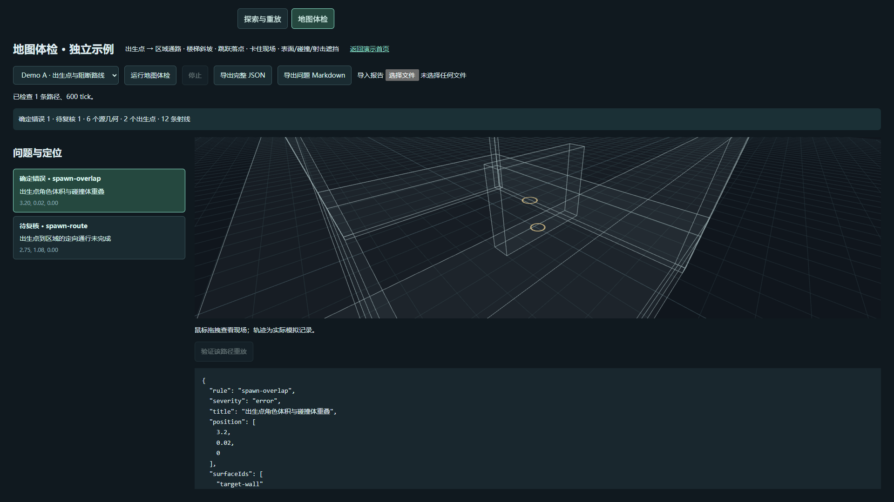
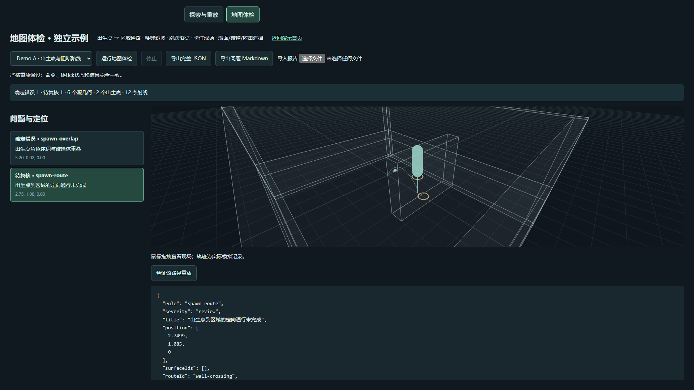

# ProbeLab

Deterministic simulation testing, map audits, failure reduction and a 3D replay workbench.

ProbeLab is an engine-independent TypeScript toolkit. This repository includes the complete browser workbench and an independent sandbox. It does **not** include XMF game code, maps, textures, credentials, or private test reports.

## Run locally

Node.js 22.12+ (24 tested), npm, and a WebGL browser:

```sh
npm ci
npm test
npm run dev
```

Open the URL printed by Vite (usually http://127.0.0.1:5173).

- **探索与重放 / Explore & replay**: independent seeded probes; pause/stop; import/export `.probe.json`; strict replay; budgeted input minimization with double verification; free camera and timeline.
- **地图体检 / Map audit**: spawn overlap/support, malformed source bounds, declared visual/collision/shot ray differences, directed spawn routes, stairs/ramps, jump landings and stalled traversal evidence. The public demo uses explicitly labelled preset fixtures.
- Export JSON to retain coordinates, surface IDs, actual per-tick commands/state and route attempts. `review` findings are candidates, not confirmed game bugs.

```sh
npm run build
npm run probe -- --help
npm run probe -- run --scenario healthy --probes 4 --ticks 240
```

## Integrate your simulation

`@probelab/core`: implement `ProbeAdapter` and a command strategy. See [the adapter contract](packages/probe-core/CONTRACT.md).

`@probelab/audit`: provide an `AuditMap` (surfaces, spawn points and explicitly directed routes) and `AuditDriver.run(route, jumpRecovery, maxTicks, cancelled)`. **Call your actual fixed-step movement/collision implementation.** Return the real commands, state snapshots, arrival status and stall measurements. See [the executable independent adapter](demo/src/probelab/demoAudit.ts).

```ts
import { auditMap, importAuditReport } from '@probelab/audit';
const report = await auditMap(map, driver, {
  maxRoutes: 48,
  maxTicksPerAttempt: 1200,
  cancelled: () => false,
});
const roundTrip = importAuditReport(JSON.stringify(report));
```

`@probelab/viewer`: render your debug world and real traces; call `dispose()` when leaving. `@probelab/cli`: use the default independent sandbox or inject a trusted registry through `main(args, registry, io)`.

## What this proves

A deterministic recorded route can be recomputed; a confirmed spawn/body overlap is a geometric error. A controller failing to traverse a route is **not** a proof that the whole map is unreachable. Visual ray comparison currently uses exact axis-aligned declared boxes; curved/rotated meshes, transparency and intentional pass-through decorations require inspection in the host renderer. This tool does not judge aesthetics, game balance or every possible player tactic, and it does not autonomously fix a map.

CI runs package tests, TypeScript and the complete browser-workbench build. Browser screenshots and real-game data are intentionally outside this public repository. This repository is MIT licensed; third-party dependencies retain their own licenses. npm packages are not published by this task.

## 中文快速使用

运行 `npm ci` → `npm test` → `npm run dev`，打开终端显示的网址。上方切换“探索与重放”和“地图体检”。示例故障均有明确标注；接入自己的地图后，体检结果会保留位置、几何ID、失败路径和重放输入。确定错误与待复核候选分开显示，导出 JSON 后可移交给开发者修复。

## Preview and acceptance





Local acceptance: 46 tests passed, no skips; standalone Chrome checks cover actual driver replay and Worker cleanup. Audit exports retain a debug geometry snapshot, so old reports can still be inspected after a map changes. Execution replay requires the current semantic source hash to match.
